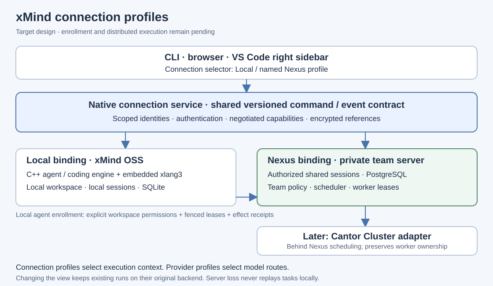

# Local and Nexus connection profiles

This is the target connection contract. The native SQLite catalog is exposed
through the authenticated local backend at `GET /v1/connections` and
`POST /v1/connections`; it stores Local/Nexus profile metadata and active
selection. Selection is revision-checked in the native catalog service, which
rejects unauthenticated Nexus activation before changing persisted state. A configured Nexus endpoint is
reported as `not_connected`, and selection fails closed until authentication
and remote command/event routing exist. The native CLI can list, save and remove
connection metadata and select an available profile; it cannot activate an
unauthenticated Nexus profile. Browser Settings can inspect the catalog and
save/remove Nexus address metadata; it does not yet select a remote profile or
authenticate to Nexus. Model-provider profiles are a separate configuration
domain.



## User experience

The sidebar has a connection selector with **Local** as the initial profile.
Settings manages named Nexus connections. The bottom model selector lists models
available in the selected connection; provider setup belongs to that connection.
CLI uses the same backend profile identity through `connections`,
`connection-save`, `connection-remove` and `connection-select`. These commands
manage public connection metadata only; provider keys and server credentials do
not pass through the catalog. Browser and VS Code are intended to be views of
the backend profile registry, rather than separate registries with copied
secrets.

Adding a Nexus URL creates an unconnected configuration. Authentication verifies
the server identity and negotiates the protocol. The server returns the user's
authorized team/project/workspace choices and capabilities. Selecting a project
then permits explicit enrollment of a local workspace as an execution endpoint.
Viewing shared sessions does not automatically authorize remote tool execution.
The local user must approve the workspace and effect policy for enrollment.

A Nexus profile can therefore provide shared session viewing without worker
enrollment, or participate in team execution after enrollment. Team controls
appear only for capabilities returned by the authenticated server and supported
by the local agent. An unavailable server is shown as unavailable; switching to
Local requires explicit selection and does not replay shared tasks.

## Backend contract

The connection service owns stable profile IDs, revisions, public status and
encrypted authentication references. Views receive no reusable server credential.
Local profiles bind the local runtime and SQLite. Nexus profiles bind an HTTPS
origin and verified server identity; shared state belongs to Nexus, and clients
never access its PostgreSQL database.

Both bindings expose one versioned command/event contract with session, run,
approval and model operations. The Local binding calls local services; the Nexus
binding performs authenticated remote requests. Remote capabilities extend the
contract through explicit negotiation. Protocol support and authorization are
checked independently on every operation; a capability flag grants no authority.
Existing local endpoints remain supported during integration. This document
does not declare a new deployed endpoint or protocol version.

Commands carry a request identity and explicit connection context. Run admission
captures that context, provider/model route and authorized workspace. Repeated
requests are reconciled against durable admission records before new effects.
Events and resume cursors are scoped to the server, connection and session.
Profile revision changes reject stale admission; changing a view's selected
profile does not transfer, cancel or reinterpret already admitted work.

| Operation | Required boundary |
| --- | --- |
| Add/edit connection | Backend validates destination and revision; credentials remain encrypted |
| Authenticate/negotiate | Verify identity and transport; reject unsupported protocol; return authorized scope |
| Select connection | Change view/new admission context; retain existing run ownership |
| Enroll workspace | Separate explicit workspace/effect authorization and worker identity |
| Accept assigned work | Validate task, workspace, lease expiry and fencing token before effects |
| Reconnect | Resume scoped events and reconcile effect receipts; do not blindly replay commands |
| Revoke enrollment | Reject new effects; reconcile in-flight effects and cancellation explicitly |

## Implementation and acceptance order

1. Native SQLite connection catalog with Local default, revision checks and
   retired-ID protection is implemented and exposed through authenticated
   HTTP. Nexus catalog entries reject client-supplied credentials and remain
   visibly unconnected; attempts to select them fail without changing Local.
   Backend-owned encrypted credential references and preservation/ownership
   tests for existing sessions and model configuration remain to be integrated.
2. Shared binding interface and connection-scoped run/event identities; verify
   that switching profiles cannot cross session, cursor or credential boundaries.
3. Private Nexus authentication and negotiation, then public authenticated client
   binding; exercise unavailable, expired and incompatible connections.
4. Authorized workspace enrollment, fenced leases and durable effect receipts;
   validate two workers, revocation, reassignment and lost replies.
5. CLI catalog management is implemented. Browser Settings reads the native
   catalog and saves/removes public Nexus metadata through the browser adapter's
   allowlisted `GET`/`POST /v1/connections` route. The right VS Code Settings
   panel shares the same client contract. Neither view can select an
   unauthenticated Nexus connection; actual remote selection, authentication,
   routing and model catalog binding remain pending.

The private server owns team policy, PostgreSQL and scheduling. Cantor Cluster
will attach behind that private scheduler/worker boundary. It must preserve
workspace authorization and ownership guarantees; clients continue using their
Nexus profile and the xMind execution engine remains reusable.

## Native xlang3 integration API

The registered xMind root exposes an authenticated Connections subobject:

```cpp
auto connections = root["Connections"](owner_token);
auto catalog = connections["List"]();
auto selected = connections["Select"]("local", catalog["revision"]);
// desired_profiles is an SDK list of dictionaries with id/name/kind/origin.
auto updated = connections["Save"](desired_profiles, catalog["revision"]);
```

List returns revision, active_id and profiles. Each profile contains id, name,
kind, origin, revision, status, command_routing and authenticated. Save accepts
only desired public configuration fields (id/name/kind/origin), not the read-only
status fields returned by List. Credentials never belong in this catalog. SDK
values are serialized/transferred by xlang3; there is no separate IPC envelope.

The existing local owner token authorizes the subobject. It retains the captured
backend generation and rejects calls after that owner retires, including after
a replacement backend binds the same root. Save and Select obey native admission
and atomic persisted revision checks. Nexus activation remains unavailable until
an authenticated binding is implemented. This API does not grant worker authority.

The unified executable can exercise these same SDK methods from another process:

```text
xmind ipc --endpoint lrpc:PORT connections list
xmind ipc --endpoint lrpc:PORT connections save REV JSON_ARRAY
xmind ipc --endpoint lrpc:PORT connections select local REV
```

XMIND_AUTH_TOKEN supplies the existing local-owner token through the environment.
The CLI JSON text is input/output presentation; calls carry SDK lists, dictionaries
and scalars across the process boundary. Separate-process and lifetime contracts
verify authorization, HTTP agreement, UTF-8 persistence, concurrent updates, stale
revision rejection, forbidden credential fields and retired-object refusal.

## Captured Local binding

Connections.Open(profile_id, expected_profile_revision) returns a Local binding
with Identity(), Sessions(), Runs(), Events(session_id, root_run_id) and RunEvents(session_id, run_id). The
revision is the profile revision, not the overall catalog revision. Open refuses
unavailable remote profiles; saving an address is not authentication.

Identity returns connection_id, profile_revision, server_id, backend_generation,
protocol_version and kind. The Local server ID is a random non-secret identity
persisted once through SQLite/xlang3. It stays stable across profile edits and
backend rebinding; another database receives another identity. Managed bindings
use the actual backend-owner generation. Standalone bindings use an ephemeral
context generation. Captured services fail after their backend retires.

Sessions supports Open/Create and Runs supports Open/Start/Cancel. Records return
a binding identity plus a session or run field. New Create/Start admissions retain
a shared profile guard through the native admission operation; catalog writers
wait for that guard. A profile edit invalidates new admissions through stale
objects but preserves reads and cancellation for already admitted work. Existing
root Sessions/Runs remain explicitly Local compatibility APIs.

Events captures one root/session. Cursor() returns server_id, connection_id,
session_id, run_id and sequence. Read(cursor) rejects mismatched scope and returns
at most 256 actual root-tree events through the existing repository query, with
a next cursor. That query also restricts every returned run to the captured
session. Local event cursors do not grant remote or workspace execution authority.

The native IPC CLI supports these captured service commands after
`xmind ipc --endpoint lrpc:PORT` (authentication comes from XMIND_AUTH_TOKEN):

- `connections open ID PROFILE_REV`
- `connections session-create ID PROFILE_REV SESSION TITLE`
- `connections session-open ID PROFILE_REV SESSION`
- `connections run-submit ID PROFILE_REV JSON_OBJECT`
- `connections run-start ID PROFILE_REV RUN SESSION PROMPT`
- `connections run-open ID PROFILE_REV RUN`
- `connections run-cancel ID PROFILE_REV RUN`
- `connections events ID PROFILE_REV SESSION ROOT JSON_CURSOR`

A null JSON cursor starts from the captured initial cursor. Run start/open return
native binding/run receipts; cancellation returns the captured identity, run ID
and acknowledgement. Cancellation requests the existing run's stop; inspect its
terminal state separately. Commands use the existing SDK service objects and
values. Start accepts the default run options; Submit accepts the options below. Browser/extension
prompt admission uses the shared native HTTP adapter; other client operations
and authenticated remote connectors still require integration.

## Captured operation service

`binding.Operations(session_id, run_id)` returns a native SDK service scoped to
one existing run in that session. `List()` returns its captured binding, session,
run and operations. `Open(operation_id)` and `Decide(operation_id, decision)`
return captured binding/operation receipts. Decision is allow or deny; the owning
backend assigns local-owner, never an actor supplied by the caller. The existing
native decision transition remains responsible for expiry and exactly-once state.
Argument JSON stays byte-for-byte unchanged. Another session/run's operation is
rejected before a decision. Metadata edits retain admitted operation reads;
backend retirement invalidates every retained service object.

CLI exposes `connections operations ID REV SESSION RUN`,
`connections operation ID REV SESSION RUN OPERATION`, and
`connections operation-decide ID REV SESSION RUN OPERATION DECISION` through
these SDK subobjects. This adds neither effect execution nor a replacement
permission engine to the adapter. Browser/extension captured approval routing,
operation output and reconciliation adapters remain separate work.

## SDK run options

The captured Runs subobject exposes `Submit(request)` in addition to
`Start(id, session, prompt)`. Request is an ordinary SDK dictionary; xlang3 owns
remote object/method calls and value serialization. SDK and HTTP use the same
native request validation and typed admission dispatch.

Required fields are `id`, `session_id` and `prompt`. Optional fields are
`model_id`, paired `provider_profile_id`/`expected_provider_revision`, paired
`expected_workspace_id`/`expected_workspace_authority_id`,
`expected_workspace_revision`, `files` and `inbox_id`. File attachments require
the observed workspace membership revision. Unknown fields, malformed revision
bindings and stale connection admission are rejected before execution. Submit
returns the same captured binding/run receipt as Start. The SDK caller supplies
the run ID; it can inspect that ID after an uncertain reply before any retry.
This API is in source; installed 0.1.62 does not advertise this new method.

## HTTP captured-binding adapter

The SDK and HTTP adapters now call the same native LocalConnectionBindings
service. The server injects the SDK owner's native service into its HTTP adapter,
so identity/generation and admission/cursor behavior are shared. Neither adapter
implements execution or persistence.

POST /v1/connection-bindings accepts id and expected_profile_revision and returns
binding_id plus identity. Authenticated requests use /v1/connection-bindings/ID:

| Method/path | Body or result |
| --- | --- |
| GET /identity | Captured public identity |
| DELETE base path | Release this HTTP handle; admitted work is retained |
| POST /sessions | id, title; returns binding/session |
| GET /sessions/SESSION | Captured binding/session record |
| POST /runs | id, session_id, prompt; returns binding/run |
| GET /runs/RUN | Captured binding/run record |
| POST /runs/RUN/cancel | Empty object; cancel through native execution |
| POST /events | session_id, run_id, optional cursor; returns bounded events/next cursor |
| GET /sessions/SESSION/runs/RUN/operations | Captured binding/session/run and operation list |
| GET /sessions/SESSION/runs/RUN/operations/OPERATION | Captured binding/operation |
| POST /sessions/SESSION/runs/RUN/operations/OPERATION/decision | decision: allow or deny; captured binding/operation |

These routes require the existing backend authentication. A view handle is bound
to the creating authenticated view and origin; another view cannot acquire it.
The local owner retains administrative access. Registry entries expire after
15 minutes idle, refresh on use and are limited to 128. Releasing or expiring a
handle does not cancel work or reinterpret its ownership. Cursor boundaries must
actually belong to the captured stream, not only contain matching labels.

Run start now accepts the same model, provider revision, workspace authority and
membership revision, file metadata and inbox identity as /v1/runs. Both routes
use one typed native request parser/dispatch path; the captured route also holds
its profile admission guard. Public provider context is retained in the response.
The SDK's three-argument Start remains available with default options.

Health advertises local_connection_admission=1. Shared browser/extension clients
lazily capture the selected available Local profile before session creation or
prompt-run admission. Read-only health does not allocate handles. The capability
absent on an older Local backend preserves its explicit legacy path. Unsupported
versions and unavailable selected profiles fail closed; failed admissions are
never retried through a fresh context or legacy endpoint. Reconciliation errors
retain the request ID and captured identity. Workspace admission guards still
attach their authority fields to scoped run requests. View/backend disposal
releases only its own handle and does not cancel admitted work.

This version scopes session creation and regular prompt runs. Graph admission,
commands, queued-input creation, general read/event/approval/model adapters and
authenticated remote binding remain to be integrated. Unit/native contracts do
not establish actual rendered verification of this new client source.

The captured operation HTTP routes delegate to the same native run-scoped service
as SDK Operations. They retain origin-bound handle authentication, reject query
parameters and caller actors, and preserve exact argument bytes. Health advertises
local_connection_operations=1. Browser/extension approval routing is still pending;
these routes alone do not establish rendered approval acceptance.

Shared browser/extension clients negotiate the operation capability and pass the
observed session/run to scoped operation list, inspection and decisions. Binding
identity and run receipts are checked without legacy retry on failure. Backends
that omit the capability retain the previous Local routes. Session permission
grants, process output/reconciliation and A2A controls remain separate APIs.
Client unit verification does not establish actual rendered approval acceptance.

Captured Sessions.Messages(session_id, before_sequence, count) returns binding,
session_id, messages, has_more and next_before. Use before_sequence=0 for the
latest page; otherwise supply an observed message sequence from that session.
Count is 1..1000. Native checks reject foreign-session cursor sequences and
fence retained objects on backend retirement. Message values use normal SDK
serialization. HTTP exposes POST /connection-bindings/ID/sessions/SESSION/messages
under /v1 with before_sequence and count; health local_connection_history=1.
Client integration and rendered verification of this API remain pending.

Browser and extension transcript paging now negotiates the history capability,
uses this captured page service, and validates binding/session receipts before
merging records. Legacy full-history, individual-message and export APIs remain
separate.470 extension/165 browser unit tests and the actual native-backed view
contract pass; no new rendered or complete native qualification is inferred.

CLI: `xmind ipc --endpoint lrpc:PORT connections messages ID REV SESSION
BEFORE_SEQUENCE COUNT` calls the same SDK Sessions.Messages method. Use0 for
the latest page and the sequence of its first message to request earlier records.
The command returns the native binding/session/page receipt; credentials remain
in the existing XMIND_AUTH_TOKEN environment flow. Independent CLI processes
verify pagination, cross-session cursor refusal and authentication.

## Captured run-history paging

The registered binding returns its existing `Runs()` subobject. `Runs.History(session_id, run_id, before_sequence, count)` reads through that captured native connection. Zero `before_sequence` starts at the newest page; count is1–1000. Results contain `binding`, `session_id`, `run_id`, chronological `messages`, `has_more` and `next_before` (`msg_N` or null). Use numeric N as the next before sequence. The cursor must belong to the selected run history, and the run must belong to the supplied session.

This preserves repository semantics: an ordinary root reads its live session conversation, including later session messages; an admitted child reads its execution-owned history. A root history is not an immutable transcript of just one prompt. Reads create no inference or effects. Profile metadata changes retain existing captured reads; backend retirement fences them.

The SDK CLI uses the same method:

```text
xmind ipc --endpoint lrpc:PORT connections run-history local PROFILE_REV SESSION RUN 0 100
```

The HTTP adapter is `POST /v1/connection-bindings/{binding}/sessions/{session}/runs/{run}/history` with `{ "before_sequence": 0, "count": 100 }`. Owner and origin-bound view handles remain principal-scoped. Its response matches the SDK page. [Focused evidence](evidence/captured-run-history-20261023.json) does not qualify a complete suite, installation or authenticated remote execution.

## Captured child-history service and shared clients

`binding.Runs().ChildHistory(session_id, parent_id, child_id)` returns `binding`, `session_id`, `parent_id`, `child_id` and chronological `messages`. The backend checks the session and existing root/child relation. Ordinary root reads retain ultimate-root admission checks; graph reads require the direct graph parent. Child messages remain execution-owned and exclude the parent conversation. SDK serialization stays inside xlang3.

HTTP uses `POST /v1/connection-bindings/{binding}/sessions/{session}/runs/{parent}/children/{child}/history` with `{}`. It retains the handle principal/origin checks. Health advertises `local_connection_child_history:1` alongside captured admission support. Browser and extension use their shared client to negotiate support, pass the active session and validate all receipt identities. Once negotiated, protocol loss, a bad receipt or a closed handle does not retry through a compatibility route. Old backends without that capability retain their established route. [Scope and validation](evidence/captured-child-history-clients-20261023.json).

## Captured graph admission

`binding.Graphs().Submit(request)` is an ordinary xlang3 SDK subobject method. The dictionary requires `id`, `session_id`, `graph_id`, `graph_revision` and `prompt`; it accepts the same optional model, provider profile/revision, workspace identity/authority/membership revision and file attachment fields as native graph admission. The backend resolves a catalog graph at its exact revision. Request-supplied executable plans and `inbox_id` are rejected. File attachments require a positive observed workspace membership revision. Results contain the immutable `binding` identity and admitted graph-root `run`.

HTTP uses `POST /v1/connection-bindings/{binding}/graph-runs` with that request (`id` may be generated by the HTTP adapter). The handle remains owner/view principal scoped. `local_connection_graph_admission:1` advertises support. The shared browser/extension client negotiates it, preserves request options and checks the returned binding, session, generated run ID and graph-root identity. Once negotiated, failure does not retry through an unbound route. SDK serialization remains inside xlang3; execution and SQLite remain backend-owned.

Graph catalog/detail, human input/resume and stream adapters retain their separate remaining work. [Focused SDK/HTTP/client and actual tool-only graph evidence](evidence/captured-graph-admission-20261023.json) is not a complete-suite or rendered editor qualification.

## Captured graph catalog and detail

`binding.Graphs().List()` returns `{binding, graphs}` with backend catalog metadata. `binding.Graphs().Open(run_id)` returns `{binding, graph}`, where `graph` preserves the native run, graph/revision, checkpoint/revision, specification, input and context metadata. SDK value transfer stays inside xlang3. Captured reads retain their original identity after profile metadata edits and fail after backend retirement.

HTTP uses `GET /v1/connection-bindings/{binding}/graphs` and `GET /v1/connection-bindings/{binding}/graph-runs/{run}`. These principal-scoped reads share native snapshot/encoding logic with compatibility graph detail. Enabled-context observations recheck checkpoint revision and run state, with the existing three-observation limit; changed snapshots produce a conflict instead of combining different states. Disabled context keeps its existing immutable-context observation rule.

`local_connection_graph_read:1` advertises the methods. The shared browser/extension client negotiates them and validates binding and requested graph-run identity. It does not retry through compatibility routes after negotiated protocol loss or a mismatched receipt. [Focused and hosted scope details](evidence/captured-graph-read-20261023.json).

## Captured graph controls

`binding.Graphs().Input(root, node, input_json, checkpoint_revision)`, `TreeInput(root, owner, node, input_json, root_revision, owner_revision)` and `Resume(root, checkpoint_revision)` are SDK subobject methods. The backend retains lifetime and owner admission, uses the local-owner actor, and delegates checkpoint and run authority to GraphService. Inputs preserve raw JSON strings; nested input requires both revisions and a nonempty owner. Input returns `{binding, graph}` without observation context; resume returns `{binding, run}`.

HTTP POST routes under `/v1/connection-bindings/{binding}/graph-runs/{root}` are `/human/{node}`, `/invocations/{owner}/human/{node}` and `/resume`. Input bodies contain `input_json` and `expected_checkpoint_revision`; nested input also contains `expected_owner_checkpoint_revision`. Resume requires `expected_checkpoint_revision`. Handles retain principal/origin checks. `local_connection_graph_control:1` negotiates shared browser/extension routing, with no fallback after a negotiated failure or drift. SDK serialization remains inside xlang3. [Evidence and remaining limits](evidence/captured-graph-control-20261023.json).

Positive context-enabled captured HTTP resume is now verified after backend close/reopen: it joins the original owner with one new budget segment and no repeated model/child execution. [Actual engine evidence](evidence/captured-context-resume-20261023.json).

## Unified CLI graph SDK calls

`xmind ipc --endpoint lrpc:PORT connections` accepts `graphs ID REV`, `graph-open ID REV ROOT`, `graph-submit ID REV JSON_OBJECT`, `graph-input ID REV ROOT NODE JSON_INPUT CHECKPOINT_REV`, `graph-tree-input ID REV ROOT OWNER NODE JSON_INPUT ROOT_REV OWNER_REV` and `graph-resume ID REV ROOT CHECKPOINT_REV`. Authentication uses XMIND_AUTH_TOKEN. These are thin calls to the captured Graphs SDK subobject with SDK-owned value transfer; they introduce no string-dispatch RPC service. Independent client processes prove actual root/nested human input and file reads. [Evidence and limits](evidence/captured-graph-ipc-20261023.json).

The loopback browser gateway now forwards captured graph catalog/detail, submit, human/nested input and resume paths, plus session-scoped run/child history. It checks each route shape and HTTP method before forwarding; backend authentication and binding principal/origin checks remain authoritative. Actual paused browser reattachment and native completion pass the repaired route. [Regression, repair and unresolved gates](evidence/captured-browser-gateway-repair-20261023.json).

## Captured graph children SDK

`binding.Graphs().Children(root)` returns `{binding, root_id, session_id, children}` for the persisted graph owner, including a nested graph invocation. Children are immediate native Run values. The captured backend lifetime gates persistence access; ordinary non-graph IDs cannot supply a graph record. `xmind ipc --endpoint lrpc:PORT connections graph-children ID REV ROOT` invokes this SDK method directly. The independent nested graph fixture uses it before scoped human input and actual native read completion. HTTP/gateway/shared-client routing is described below; captured SSE remains unfinished. [Scope](evidence/captured-graph-children-sdk-20261023.json).

## Captured graph children HTTP/client

`GET /v1/connection-bindings/{binding}/graph-runs/{root}/children` returns the SDK child receipt and retains principal/origin scope. It accepts no query parameters. `local_connection_graph_children:1` advertises support with captured admission. The browser gateway permits only GET on that path. The shared browser/extension client checks binding identity, requested graph owner, session identity, immediate parent, unique child IDs and native Run shape. Protocol loss, identity drift and a closed context do not retry through legacy routes. Backends without negotiated support keep the existing compatibility read. [Actual native/controller and client evidence](evidence/captured-graph-children-clients-20261023.json). SSE remains a separate adapter requirement.

## Single-run event observation

`binding.RunEvents(session_id, run_id)` returns a standard registered xlang3 Events subobject. Call `Cursor()` for its initial cursor and `Read(cursor)` for committed records. SDK values use the existing native list/dictionary conversion. The backend validates the session/run and cursor namespace on every read; child runs are supported and no descendant records enter a run-only page. `Events(session_id, root_id)` retains root-tree semantics. Both object types reject reads after backend retirement.

Independent clients can use `xmind ipc --endpoint lrpc:PORT connections run-events local PROFILE_REV SESSION RUN JSON_CURSOR`, with `null` as the initial cursor. The HTTP adapter exposes `GET /v1/connection-bindings/{binding}/sessions/{session}/runs/{run}/events/stream?after=SEQUENCE`, negotiated by `local_connection_run_stream:1`. Opening observations carry the captured identity; clients must retain that binding on reconnect and refuse a changed identity. This is read-only observation, never execution replay. [Focused validation](evidence/captured-run-stream-clients-20261023.json).

## Captured model catalog

`binding.Models().List()` reads the captured backend model catalog through ordinary xlang3 SDK calls. It returns binding identity, default_model and models (id entries); no provider credentials are exposed. Independent clients use `xmind ipc --endpoint lrpc:PORT connections models local PROFILE_REV`. The HTTP adapter is `GET /v1/connection-bindings/{binding}/models`, negotiated by `local_connection_models:1`. Existing Local `/v1/models` and the captured adapter share the native encoder. Reads retain the original generation and reject backend retirement. Session model selection/provider changes remain separate APIs. [Validation](evidence/captured-model-catalog-clients-20261023.json).

## Captured session model choice

`binding.Models().Open(session)` returns `{binding, model}` with the existing session model state. `Select(session, request)` uses exactly `{model_id, provider_profile_id, expected_provider_revision, expected_revision}`. A null model_id clears the override. Session and active provider revisions must match; the native provider runtime retains idle-state and route/catalog admission rules. The connection profile revision must also remain admitted before a mutation. Read-only observation retains its original backend generation.

The HTTP adapter is GET/POST `/v1/connection-bindings/{binding}/sessions/{session}/model`, negotiated by `local_connection_model_selection:1`. CLI SDK calls are `connections model-open ID REV SESSION` and `connections model-select ID REV SESSION JSON_OBJECT` after `xmind ipc --endpoint lrpc:PORT`. The SDK uses registered Models methods and native list/dictionary conversion. [Evidence and limits](evidence/captured-model-selection-clients-20261023.json) distinguish actual native HTTP selection from positive separate-process SDK/rendered selection still needing acceptance.

Positive separate-process `Models.Open/Select` is now verified: distinct xmind.exe clients select/clear an actual native provider-bound model, stale revisions reject, and backend restart preserves revision2 with no inference. [Focused SDK evidence](evidence/captured-model-selection-sdk-positive-20261023.json). Rendered selection remains separate.

## Captured workspace commands

`binding.Commands().List()` returns binding identity, workspace_id/authority_id and the native Markdown command catalog. `Invoke(session, request)` accepts id, command_id, optional arguments/model/provider binding/graph binding, and required expected_workspace_id/expected_workspace_authority_id. SDK callers supply a unique run id; the HTTP adapter can generate it. Templates expand as prompt text in the backend and never execute as shell/scripts. Single and graph submissions retain the existing native admission path.

CLI methods are `connections commands ID REV` and `connections command-invoke ID REV SESSION JSON_OBJECT` after `xmind ipc --endpoint lrpc:PORT`. HTTP uses GET `/v1/connection-bindings/{binding}/commands` and POST `/v1/connection-bindings/{binding}/sessions/{session}/commands`, negotiated by `local_connection_commands:1`. Clients retain immutable connection identity; a refused admission must never fall back or replay through another profile. [Exact acceptance scope](evidence/captured-commands-clients-20261024.json) includes positive SDK/HTTP graph-backed reads; ordinary model-backed and rendered command acceptance remain separate.

Ordinary non-graph Commands.Invoke is now verified through a separate xmind.exe SDK client: one controlled model request, persisted user/assistant pair, literal arguments and duplicate-ID refusal without repeated inference. [Focused evidence](evidence/captured-ordinary-command-sdk-20261024.json). Rendered browser/editor command acceptance remains separate.

## Captured workspace metadata

`binding.Workspace().Info()` returns `{binding, workspace}` with configured/root/workspace_id/authority_id. `Membership()` returns `{binding, membership}` with the existing revision/folder snapshot. Reads retain their original backend generation, revalidate workspace identity and reject retirement. Info reports an unconfigured workspace when there is no executor; Membership requires an opened native root.

CLI methods are `connections workspace-info ID REV` and `connections workspace-membership ID REV` after `xmind ipc --endpoint lrpc:PORT`. HTTP GET routes are `/v1/connection-bindings/{binding}/workspace` and `/workspace/membership`, negotiated by `local_connection_workspace:1`. Existing Local compatibility routes share their encoders. [SDK, gateway and shared-client evidence](evidence/captured-workspace-clients-20261024.json) does not establish file browsing or remote routing.
